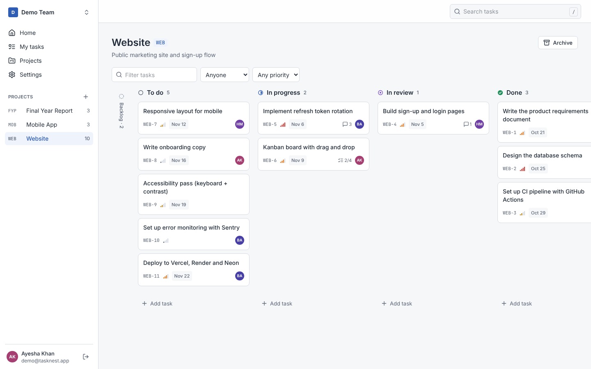
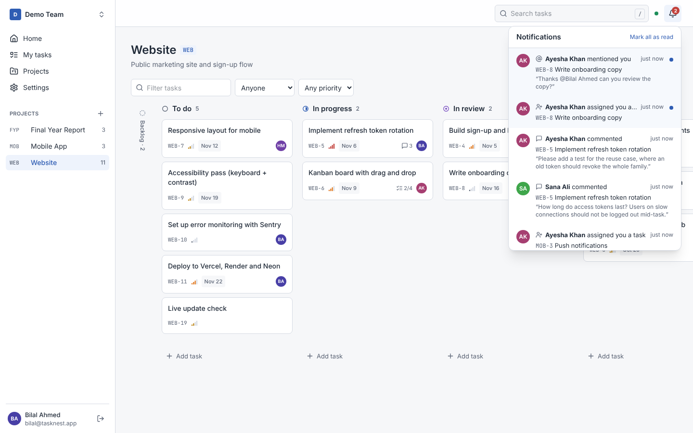
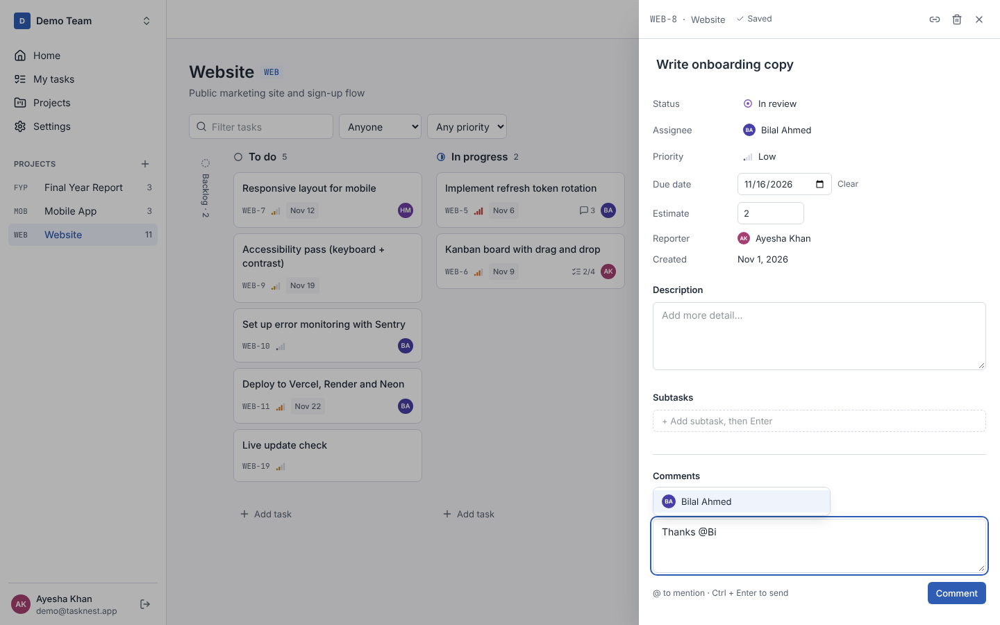
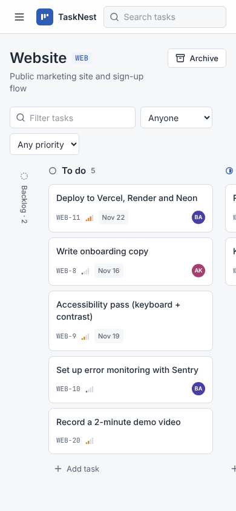

# TaskNest

A multi-tenant project management SaaS for small teams: workspaces, role-based access, projects, Kanban boards with drag and drop, subtasks, threaded comments with @mentions, in-app notifications and real-time updates.
Built as a portfolio project with **Next.js, Express, PostgreSQL and TypeScript**.



**Demo login:** `demo@tasknest.app` / `password123` (after running the seed, see below)

## Features

| Area | What it does |
| --- | --- |
| Kanban board | Six status columns, drag and drop with mouse, touch or keyboard, optimistic updates, quick add, filters by assignee, priority and text |
| Tasks | Per-project IDs (WEB-42), assignee, priority, due date with overdue highlighting, estimate, description, one level of subtasks with progress |
| Task drawer | Opens over any page with its own shareable URL; every field editable inline with "Saving… / Saved" feedback |
| Comments | Threaded replies, **@mentions with autocomplete**, edit your own, admins can delete any; guests can comment |
| Notifications | Bell with unread badge for assignments, mentions, comments on your tasks and tasks due within 24 hours (background job); click to open the task |
| Real-time | Socket.IO: boards, task details, comments and the bell update instantly for everyone in the workspace; JWT-authenticated sockets, membership-checked rooms |
| My tasks | Everything assigned to you across projects, grouped into Overdue, Today, This week, Later |
| Search | Full-text search on titles and descriptions (PostgreSQL `tsvector` + GIN index), or jump straight to `WEB-42`; press `/` anywhere |
| Projects | Create with an auto-suggested key, lead and dates; progress bars; archive and restore |
| Workspaces | Custom URL with live availability check, switcher, invites with copyable link, roles: Owner > Admin > Member > Guest |
| Sign-in | Email + password, or **Continue with Google** (OAuth 2.0 with CSRF state check, account linking by verified email) |
| Email | Invite emails through Resend when a key is set; otherwise the link is shown to copy |
| Security | bcrypt, 15-minute JWT access tokens, rotating HttpOnly refresh cookies with reuse (theft) detection, rate-limited login, Helmet headers |
| Tenant isolation | Every query is scoped to the workspace; non-members get `404` so workspace names never leak |
| Quality | 57 API integration tests against real PostgreSQL, end-to-end browser tests, GitHub Actions CI, responsive down to 360 px, light and dark mode, WCAG-minded focus states and labels |

| Notifications | @mentions | Mobile |
| --- | --- | --- |
|  |  |  |

## Tech stack

| Layer | Choice |
| --- | --- |
| Frontend | Next.js 15 (App Router), React 19, Tailwind CSS 4, TanStack Query, dnd-kit |
| Backend | Node.js 22, Express 5, Socket.IO, Zod, pino |
| Database | PostgreSQL 16, Kysely (type-safe SQL), SQL migrations, triggers, partial and GIN indexes |
| Shared | `@tasknest/shared`: one set of Zod schemas and types used by both apps |
| Testing | Vitest + Supertest (API), Playwright (end to end) |
| CI / Deploy | GitHub Actions; Vercel (web) + Render (API) + Neon (database) |

## Quick start

Requirements: Node.js 22, pnpm 10, Docker Desktop. **Using VS Code? Follow [docs/VSCODE_GUIDE.md](docs/VSCODE_GUIDE.md)** (also as a Word file in `docs/`).

```bash
pnpm install
pnpm first-run     # creates .env files, starts PostgreSQL in Docker, migrates, loads demo data
pnpm dev           # API on http://localhost:4000, web on http://localhost:3000
```

Open http://localhost:3000 and log in as `demo@tasknest.app` / `password123`.
Other demo users: `bilal@` (admin), `hira@` (member), `sana@` (guest), all `@tasknest.app` with the same password.

| Command | What it does |
| --- | --- |
| `pnpm test` | 57 API integration tests (uses the `tasknest_test` database) |
| `pnpm typecheck` | TypeScript checks for every package |
| `pnpm db:seed` | Reset the demo workspace |
| `pnpm db:migrate` | Apply new migrations |
| `pnpm build` | Production build |

## How it works

```
Browser ──> Next.js (Vercel) ──/api/* rewrite──> Express API (Render) ──> PostgreSQL (Neon)
   └───────────── WebSocket (Socket.IO, JWT auth) ──────┘
```

- **One origin for the browser.** Next.js proxies `/api/*` to the API, so the refresh cookie stays first-party everywhere.
- **Board ordering.** Cards use fractional `position` values: a move writes one row, placed at the midpoint between its new neighbours. If a gap gets too small the column is renumbered in the same transaction.
- **Task numbers.** A `BEFORE INSERT` trigger increments a per-project counter under a row lock, so concurrent inserts never get the same `WEB-n`.
- **Live updates.** Services publish small events (`task.changed`, `comment.changed`, `notification.created`) to workspace or user rooms; the browser invalidates the matching TanStack Query caches, so every screen refreshes itself.
- **Notifications.** Created in the same request as the change that causes them (never for the actor). A 15-minute job with a PostgreSQL advisory lock sends "due soon" notices once per due date.
- **Layering.** Routes (HTTP + validation) → services (rules, permissions) → SQL. Every query takes the workspace id.

```
tasknest/
├── apps/api/        Express API: migrations, scripts (migrate, seed), src/modules/{auth,workspaces,projects,tasks,comments}, test/
├── apps/web/        Next.js app: src/app (routes), src/components (Board, TaskDrawer, AppShell), src/lib (API client, hooks)
├── packages/shared/ Zod schemas + types for both apps
├── docs/            PRD, TRD, App Flow, UI/UX Brief, Backend spec, Plan, VS Code guide, screenshots
└── .vscode/         recommended extensions, debug configs, tasks, database connection
```

## API overview

All routes are under `/api/v1`. Workspace routes are under `/w/:slug` and require membership.

| Method | Path | Minimum role |
| --- | --- | --- |
| POST | `/auth/register` · `/auth/login` · `/auth/refresh` · `/auth/logout` | Public |
| GET | `/me` | Signed in |
| POST | `/workspaces` | Signed in |
| GET / PATCH / DELETE | `/w/:slug` | Guest / Admin / Owner |
| GET · PATCH · DELETE | `/w/:slug/members[/:userId]` | Guest · Admin · Admin or self |
| GET · POST · DELETE | `/w/:slug/invitations[/:id]` | Admin |
| GET · POST | `/invitations/:token[/accept]` | Public · Signed in |
| GET · POST · GET · PATCH | `/w/:slug/projects[/:key]` | Guest · Admin · Guest · Admin |
| GET · POST | `/w/:slug/projects/:key/tasks` | Guest · Member |
| GET · PATCH · DELETE | `/w/:slug/tasks/:ref` | Guest · Member · Member |
| PATCH | `/w/:slug/tasks/:ref/move` | Member |
| GET | `/w/:slug/my-tasks` · `/w/:slug/search?q=` | Guest |
| GET · POST | `/w/:slug/tasks/:ref/comments` | Guest |
| PATCH · DELETE | `/w/:slug/comments/:id` | Author · Author or Admin |
| GET · POST | `/w/:slug/notifications` · `/w/:slug/notifications/read` | Any member |
| GET | `/auth/providers` · `/auth/google` · `/auth/google/callback` | Public |

Errors always use one shape: `{ "error": { "code", "message", "fields?", "requestId" } }`.
Try every endpoint from VS Code with `apps/api/http/api.http` (REST Client extension).

## Optional integrations

| Feature | Variables (in `apps/api/.env`) | Without them |
| --- | --- | --- |
| Google sign-in | `GOOGLE_CLIENT_ID`, `GOOGLE_CLIENT_SECRET` | Google button hidden |
| Invite emails | `RESEND_API_KEY`, `EMAIL_FROM` | Invite link shown to copy and printed in the API log |

Setup steps: [VS Code guide, section 11.4](docs/VSCODE_GUIDE.md#114-optional-google-sign-in-and-invite-emails).

## Deploy

Step-by-step instructions for Neon, Render and Vercel are in [docs/VSCODE_GUIDE.md, section 11](docs/VSCODE_GUIDE.md#11-deploy-a-free-live-demo).
Note: Render's free tier sleeps when idle, so the first request can take about 30–50 seconds.

## Documentation

The project was planned before it was built. All documents are in [`docs/`](docs): product requirements (PRD), technical requirements (TRD), app flow, UI/UX brief, backend specification, 14-week project plan, and the VS Code guide.

## Roadmap

- [x] Auth, workspaces, members, roles, invitations
- [x] Projects, tasks, Kanban board with drag and drop, subtasks
- [x] Task drawer, threaded comments, My tasks, full-text search
- [x] Google sign-in, @mentions, in-app notifications, due-soon reminders (v1.1)
- [x] Real-time updates with Socket.IO, invite emails (v1.2)
- [ ] File attachments and a daily overdue email digest
- [ ] Custom statuses per project, list view, dark-mode toggle

## License

MIT © 2026 Muhammad Sulaiman
